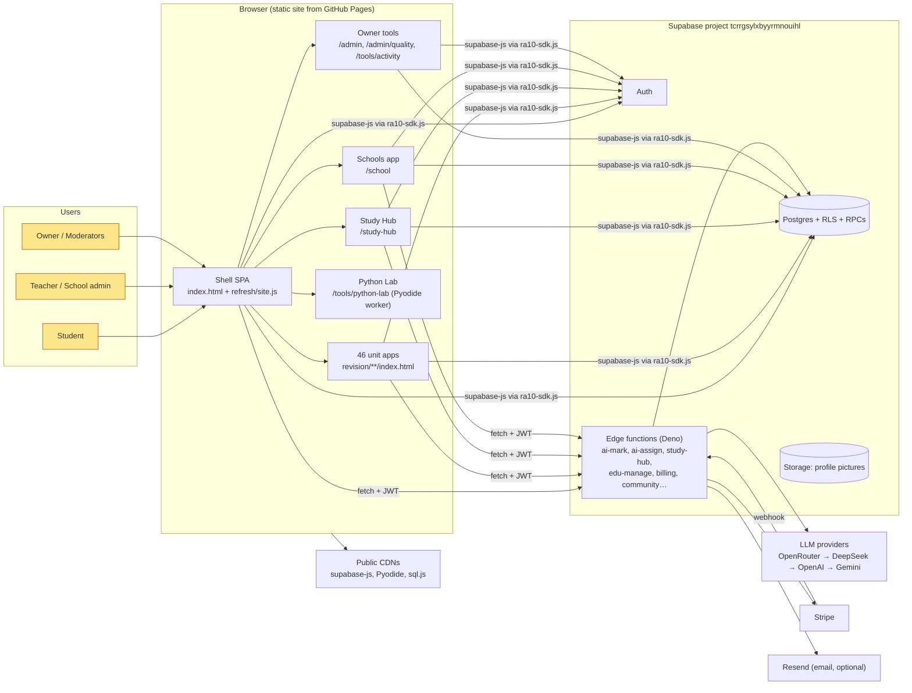
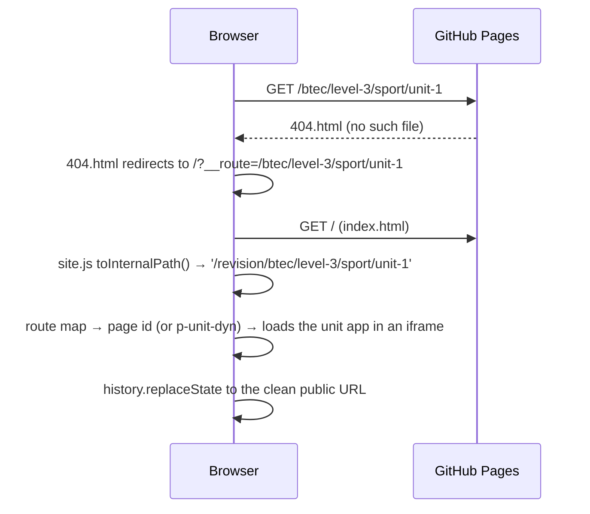

# 01 — System Architecture

## 1. System context



**The frontend has no build step.** Every page is hand-written HTML, CSS and plain JavaScript (IIFEs and `window.*` globals), served as-is. "Generated" files (unit apps, papers data) are produced offline by Python scripts in `training-data/` and committed.

## 2. Components

| Component | Location | Responsibility |
|---|---|---|
| **Shell SPA** | `index.html` (markup), `refresh/site.js` (~7.9k lines), `refresh/site.css` | Clean-URL router, navbar, homepage (signed-out marketing and signed-in dashboard), subject/unit landing pages, auth, account, upgrade, leaderboard, community, news, exams calendar |
| **SDK** | `ra10-sdk.js`, exposed as `window.RA10` | Supabase client, auth, profile, tier, credits, legal-terms gate, paywall, checkout, AI calls (`examineAnswer`, `aiMarkAnswer`, `askAiAssigner`, `markAssignment`, `transcribeWork`), streaks |
| **Unit registry** | `refresh/ra10-units.js` (`RA10_UNITS`, `RA10Units`) and `refresh/ra10-subjects.js` (`RA10Subjects`) | The one catalogue of unit apps (path, subject, qualification, colour, kind, keywords). Navbar finder, homepage, Study Hub, EDU, quality and onboarding all read it |
| **Unit apps** | `revision/<board>/<level>/<subject>/unit-N/` and `revision/a-level/<slug>/` | Self-contained revision apps: guide, spec, quiz, flashcards, question bank, past and RA10 papers, AI Examiner, assignment help |
| **Shared unit UI** | `revision/shared/unit-ui.{js,css}`, with lazy `unit-edu.js` and `unit-feedback.js` | Common dashboard and navigation across every unit; tracking hooks; sign-in gate on downloads; catalogue export (`?ra10catalog=1`); assignment runner; feedback widgets |
| **Shared engines** | `revision/btec/level-3/business/shared/`, `revision/btec/level-3/shared-aaq/`, `revision/a-level/shared/`, `revision/a-level/shared-alevel/` | Content APIs (`BizBank` K/M/TF/F), guide renderer (`BizGuide` S.* diagrams, H.* blocks), papers engine (`biz-papers`, `aqa-papers`) |
| **Site chrome reuse** | `refresh/ra10-site-chrome.js` | Lets standalone pages (Study Hub, School) reuse the shell's real navbar, mobile dock and sheets |
| **Gamification** | `refresh/ra10-xp.js`, `refresh/ra10-leaderboard.js`, SQL `increment_xp`, `xp_rate`, `leaderboard-*.sql` | XP awards (server-guarded), weekly leaderboard, boosts, podium |
| **Tracking** | `refresh/ra10-track.js` (`RA10Track.log`) → `activity_events` | Learning-activity log used for EDU progress, XP integrity and quality usage |
| **AI assistant** | `refresh/ra10-ai.js`, `ra10-ai-helper.js`, `ra10-ai.css`, `ai_chats*` tables | In-app AI chat with history |
| **Study Hub** | `study-hub/` and the `study-hub` edge function | AI daily lessons (Premium), lesson player, course paths, coding steps (`code-runner.js`) |
| **EDU / Schools** | `school/`, `admin/`, `refresh/ra10-edu.js`, `edu-platform.sql`, `edu-manage` function | Schools, classes, invites, assignments, submissions, AI reports (not public yet) |
| **Community** | `refresh/community/{forum,apps}.{js,css}`, `community-*.sql`, `community-*` functions | Forums, study-app library, AI moderation, staff and moderator workflow |
| **Quality** | `admin/quality/`, `revision/shared/unit-feedback.js`, `quality.sql`, `tools/quality/build_bench.py` | Owner-only per-unit quality scores, learner feedback inbox, content audit, AI-marking benchmark |
| **Python Lab** | `tools/python-lab/` | 58 auto-checked Python tasks, run in the browser with Pyodide 0.26.4 |
| **Content pipelines** | `training-data/**` (git-ignored sources) | PDF → text → parsers → generated JS data, plus hand-written content parts |

## 3. Key runtime flows

### 3.1 Page load and routing



- Internal route keys start with `/revision/...`. Public URLs drop the prefix (`/revision` → `/subjects`, `/revision/btec/...` → `/btec/...`).
- Listen for the `ra10:route` event; do not use `hashchange`. Old `#/x` links still work.
- **Never add a top-level folder whose name matches a route** (for example `/community`), or GitHub Pages will serve the folder instead of the SPA.

### 3.2 AI Examiner (marking an exam answer)

```mermaid
sequenceDiagram
  participant U as Unit app (biz-papers / aqa-papers)
  participant SDK as RA10.examineAnswer
  participant F as edge fn ai-mark
  participant M as examiner module (by spec_code)
  participant L as LLM providers
  U->>SDK: question object + student answer
  SDK->>SDK: gate (signed in, legal terms, credits)
  SDK->>F: POST with JWT
  F->>F: verify user, read profiles.tier / unlimited_credits
  F->>M: route (psychology 7182, edexcel 9BS0, AQA 7132/7138, BTEC business, sport U2, generic)
  M->>L: prompt with mark scheme + level descriptors
  L-->>F: JSON marks, levels, feedback
  F-->>SDK: result
  SDK-->>U: render; unit-ui dispatches 'ra10:ai-marked' (feedback "was this fair?")
```

### 3.3 Study Hub lesson generation

1. The client asks the edge function `study-hub` with `action:'plan'` for today's plan.
2. To ground the lesson, the client loads the unit's catalogue in a hidden iframe: `<unit>/index.html?ra10catalog=1`. `unit-edu.js` posts `{type:'ra10:catalog', catalog}` back.
3. `action:'create'` sends the catalogue extract. The function generates the steps with `askJson(..., {preferStrong:true})`, then runs a second verification pass. The trial or Premium rule comes from `study_hub_premium()`.
4. Exam steps are marked client-side through the real AI Examiner (`RA10.examineAnswer`). `action:'complete'` records the result, awards XP and writes the EDU submission when the lesson was assigned.

### 3.4 Credits and payments

- Tiers and credit costs are defined client-side in `ra10-sdk.js` (`TIER_INFO`). The database enforces that credits can only go **down** from the client (trigger `prevent_profile_privilege_escalation`). Increases happen only through server code: Stripe webhook, `reset_monthly_credits()` and `apply_school_entitlement()`.
- **Payments are currently paused:** `TRANSITION_MODE = true` gives every signed-in user unlimited use. Checkout also checks the `PAYMENTS_ENABLED` secret.
- Stripe flow: `create-checkout` → Stripe Checkout → `stripe-webhook` (signature-verified) updates `profiles` → `confirm-checkout` / `billing-status` for the UI → `create-billing-portal` to manage. The `gocardless-*` function folders are empty leftovers.

### 3.5 XP integrity

- The client calls `rpc('increment_xp', {amount})`.
- The SQL function (`security definer`) does the following:
  - caps each call at 100 XP;
  - applies per-minute and per-day rate limits (`xp_rate`);
  - for awards of 10 XP or more, requires genuinely recent learning in `activity_events`;
  - rejects nonsense answers with `xp_answer_is_meaningful()`.
- The client layer (`ra10-xp.js` / `ra10-refresh.js`) also blocks session start/end farming.

## 4. Deployment topology

| Piece | How it ships | Who |
|---|---|---|
| Static site | Push to `main` → `.github/workflows/jekyll-gh-pages.yml` rsyncs the repo (excluding `supabase/`, `training-data/`, `tools/` except `tools/activity`, `.claude/`, `enterprise/`, `specs/`, `.specify/`) → GitHub Pages | Anyone with push access |
| Edge functions | `npx supabase functions deploy <name>` (CLI linked to project `ra10`) | Owner only |
| SQL | Pasted by hand into the Supabase SQL editor, in the order given in [03-data-model.md](03-data-model.md#migration-order) | Owner only |
| Secrets | Supabase function secrets (LLM keys, Stripe keys and price IDs, `RESEND_API_KEY`, `SITE_URL`, `PAYMENTS_ENABLED`) | Owner only |

**Note on `tools/`:** the workflow excludes `tools/` and copies back only what the site links to: `tools/activity/` and `tools/python-lab/`. Until 12 Nov 2026 `python-lab` was missing from that list, so Python Lab was not live (risk R-12, now fixed in the workflow). When you add a new public page under `tools/`, add an rsync line for it.

## 5. Architectural characteristics (honest assessment)

| Strength | Weakness |
|---|---|
| No build step: anyone can edit and ship quickly | No module system, types, bundling or tree-shaking; `site.js` is 7.9k lines |
| Fully static frontend: cheap, fast, CDN-cached | Cache invalidation is manual (`?v=` strings across up to 46 pages) |
| Unit apps are self-contained and can be rebuilt independently | Some engine code is duplicated per family (business/shared, shared-aaq, shared-alevel); fixes do not propagate |
| RLS and security-definer RPCs guard the important writes | The schema is not fully version-controlled; there are no migrations tool, tests or staging project |
| Provider-agnostic LLM fallback chain | Owner identity is a hard-coded email in 40+ places |
| Strong content QA tooling in the pipelines | No CI gate runs that tooling |

See [08-enterprise-migration-roadmap.md](08-enterprise-migration-roadmap.md) for how to fix the weaknesses without a big-bang rewrite.
