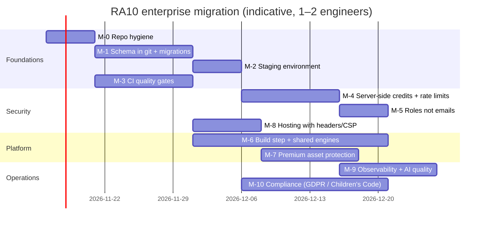

# 08 — Enterprise Migration Roadmap

**Principle:** migrate incrementally. Keep the site shippable every week, with no big-bang rewrite. Each milestone has an exit criterion you can verify.

| ID | Milestone | Work | Exit criterion |
|---|---|---|---|
| **M-0** | Repo hygiene | Untrack `supabase/.temp`. Untrack and purge the 11 Pearson PDFs (owner approval: history rewrite). Delete the `gocardless-*` folders. Move `tools/gen_*`/`patch_*` to `tools/archive/`. Add `CODEOWNERS` and branch protection on `main` | `health_check.py` reports 0 failures; no PDFs in `git ls-files` |
| **M-1** | Schema in git | `npx supabase db dump` → baseline. Convert `supabase/sql/*.sql` into ordered `supabase/migrations/<ts>_*.sql`, removing duplicate function definitions (R-02). Keep `supabase/sql/` as an archive | `supabase db reset` on a fresh project reproduces production (diff = empty) |
| **M-2** | Staging | Second Supabase project, or Supabase branching. A Pages preview or a second domain pointing at staging. Seed script with test users for each tier and role | Every PR can be tested end to end against staging |
| **M-3** | CI gates | GitHub Actions on PRs: `node --check` for all JS, `python enterprise/scripts/health_check.py`, `node training-data/btec/level-3/aaq-build/check_units.js`, the Playwright smoke test (`browser_test.py`, against a local `http.server`), `deno check` and `deno lint` for functions, and pgTAP tests | Merge is blocked unless every check passes |
| **M-4** | Server-side money and abuse controls | `spend_credits(action)` RPC (atomic, `security definer`), called inside `ai-mark`, `ai-assign`, `ai-transcribe` and `study-hub`. Per-user rate-limit table. Strict CORS. Provider spend caps | A direct `curl` to `ai-mark` without credits is refused; load test shows the limiter works |
| **M-5** | Roles | `app_roles(user_id, role)` plus `is_owner()` / `has_role()` SQL functions; JWT custom claim; replace the 40+ email checks; admin UI to grant roles | `grep -r mistry.hashim` finds only docs |
| **M-6** | Build step | Introduce Vite (or esbuild) **without changing the runtime model**: bundle `refresh/*` and `revision/shared/*` with hashed filenames (this ends manual `?v=`). Move one engine package `@ra10/engines` with family adapters to replace the three `biz-*` copies. TypeScript via JSDoc `// @ts-check` first, then gradual `.ts` | One version of each engine; zero `?v=` strings maintained by hand |
| **M-7** | Premium content | Decide per asset type: keep public, or serve via signed URLs / an edge function. Papers PDF export stays gated by sign-in | Locked content cannot be fetched anonymously |
| **M-8** | Hosting | Move static hosting to Cloudflare Pages or Netlify. Keep clean URLs with real rewrites (this removes the `404.html` bounce). Add CSP, HSTS and `frame-ancestors`; SRI on CDN scripts | securityheaders.com grade A; deep links return 200 |
| **M-9** | Observability and AI quality | Sentry (frontend and functions). Structured logs from edge functions. LLM cost dashboard per function. Nightly AI-marking benchmark (`admin/quality/bench`) with alerts. Server-side XP credibility scoring | An alert fires on error spikes or an accuracy drop |
| **M-10** | Compliance | DPIA; retention per table (`activity_events`, `ai_chats`, `study_lessons`, `content_feedback`); user data export and delete RPCs; processor register; Children's Code review; accessibility audit (WCAG 2.2 AA) | Documented and tested deletion and export |

## What NOT to change early

- **The content APIs (`K/M/TF/F`, `BIZ_GUIDE_DATA`, the paper object).** Over 46 units of hand-written content depend on them. Wrap them; do not rename them.
- **The `?ra10catalog=1` protocol.** Study Hub, EDU, quality and onboarding all depend on it.
- **Public URLs.** They are SEO-indexed (`sitemap.xml`).
- **localStorage keys.** Changing them silently resets user progress, revision ticks and Python Lab progress.

## Suggested team responsibilities

| Area | Owner role |
|---|---|
| Content pipelines and quality bar | Content engineer + subject reviewers |
| Shell, unit UI and engines | Frontend engineer |
| Supabase (schema, RLS, functions) | Backend engineer |
| AI examiners and Study Hub prompts | AI engineer (with the benchmark as the gate) |
| Billing, legal and data protection | Product owner + DPO |
