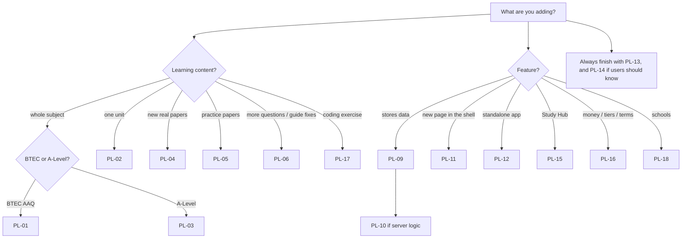

# RA10 Playbook: pipelines for changing and adding to the platform

Every repeatable change to RA10 has a pipeline here. Each pipeline lists:

- **When** to use it;
- **Inputs** you need;
- **Steps** in order;
- **Verify**: the exit gate. Do not call it done until every line passes;
- **Pitfalls** seen in practice;
- the matching **Claude Code skill** in `.claude/skills/`, if one exists.

Read **[PL-00 Conventions](PL-00-conventions.md)** once before using any pipeline.

## Index

### Content: adding data (the most common work)

| ID | Pipeline | Typical effort |
|---|---|---|
| [PL-01](PL-01-new-btec-aaq-subject.md) | New BTEC AAQ subject (several units) | 1–3 weeks |
| [PL-02](PL-02-new-or-rebuilt-btec-unit.md) | New unit in an existing BTEC subject, or a rebuild | 1–3 days per unit |
| [PL-03](PL-03-new-a-level-subject.md) | New A-Level subject (parse papers, build app, AI examiner) | 1–2 weeks |
| [PL-04](PL-04-new-exam-series-papers.md) | Add a new exam series (real past papers released) | 0.5–1 day |
| [PL-05](PL-05-ra10-practice-papers.md) | Write RA10 practice papers | 0.5 day per paper |
| [PL-06](PL-06-expand-unit-content.md) | Expand or fix content in an existing unit (bank, quiz, cards, guide) | Hours |
| [PL-07](PL-07-ai-examiner-module.md) | New AI Examiner module for a specification | 1–2 days |
| [PL-08](PL-08-ai-benchmark-set.md) | AI-marking benchmark set (accuracy gate) | 1 day |
| [PL-17](PL-17-python-lab-task.md) | Python Lab task | 30 min per task |

### Platform: adding features

| ID | Pipeline |
|---|---|
| [PL-09](PL-09-database-migration.md) | Database change (table, column, RPC, RLS) |
| [PL-10](PL-10-edge-function.md) | New or changed edge function |
| [PL-11](PL-11-shell-page-or-route.md) | New shell page, route, or homepage section |
| [PL-12](PL-12-standalone-app.md) | New standalone app or tool (like Python Lab or Study Hub) |
| [PL-15](PL-15-study-hub-extension.md) | Study Hub: a new step type or coding language |
| [PL-16](PL-16-pricing-billing-legal.md) | Pricing, tiers, credits, billing or legal-terms change |
| [PL-18](PL-18-edu-feature.md) | Schools/EDU feature (new assignment item type, role or report) |

### Shipping

| ID | Pipeline |
|---|---|
| [PL-13](PL-13-release.md) | Release: checks, cache busting, deploy, rollback |
| [PL-14](PL-14-news-and-announcement.md) | News article and site announcement |

## Decision tree: "I want to add…"

